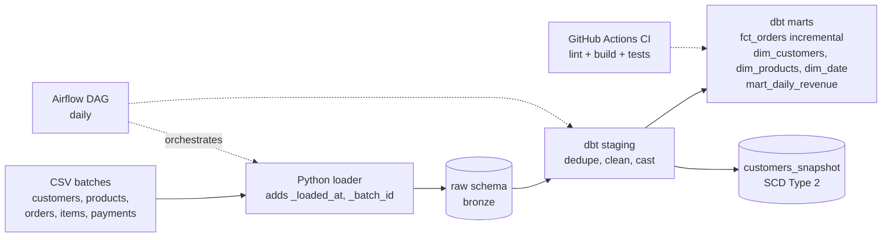

# Retail ELT Pipeline (Python → DuckDB/Snowflake → dbt → Airflow)

An end-to-end ELT pipeline for retail order data: raw ingestion with lineage columns, a tested dbt
transformation layer (staging → star-schema marts), an incremental fact table, SCD Type 2 customer
history, and an Airflow DAG with CI. Runs locally in three commands with no accounts; switches to
Snowflake with one environment variable.

## Problem

Order, item, payment and customer feeds arrive as CSV batches with duplicates, inconsistent status
values, impossible timestamps and orphaned rows. Analysts need trustworthy daily revenue and
customer metrics, and the pipeline must be safe to re-run and cheap to rebuild.

## Architecture



| Layer | Schema | Materialization | Purpose |
|---|---|---|---|
| Raw | `raw` | tables (Python) | Immutable landing zone, one row per received record |
| Staging | `staging` | views | Dedupe, normalize, cast. One model per source |
| Marts | `marts` | tables / incremental | Star schema and reporting marts |
| Snapshots | `snapshots` | SCD2 table | History of customer city/state changes |

## Quick start

```bash
python -m venv .venv && source .venv/bin/activate
make setup          # install dependencies
make all            # generate day-1 data, load raw, dbt build (models + tests)
make day2           # new batch: incremental fact + SCD2 snapshot
make docs           # dbt docs + lineage graph at http://localhost:8080
```

Want the real Olist dataset? Put its CSVs in `data/raw/` using the column names in
`ingestion/generate_sample_data.py` (rename columns as needed), then run `make load build`.

### Snowflake instead of DuckDB

```bash
pip install dbt-snowflake "snowflake-connector-python[pandas]"
export SNOWFLAKE_ACCOUNT=... SNOWFLAKE_USER=... SNOWFLAKE_PASSWORD=... \
       SNOWFLAKE_WAREHOUSE=... SNOWFLAKE_DATABASE=... SNOWFLAKE_ROLE=...
python ingestion/load_raw.py --target snowflake --mode replace
DBT_TARGET=snowflake dbt build --project-dir retail --profiles-dir retail
```

The Snowflake path uses portable SQL (cross-database dbt macros for date math, a recursive CTE for
the date spine) but has not been run against a live Snowflake account yet.

## Data quality: what profiling found and how it is handled

| Problem in raw data | Where handled | Safeguard |
|---|---|---|
| Duplicate order rows (~2%) | `stg_orders`: keep latest `_loaded_at` per `order_id` | `unique` test on `order_id` |
| Mixed-case / padded status (`" Delivered "`, `SHIPPED`) | `stg_orders`: `lower(trim())` | `accepted_values` test |
| Delivered before purchased (~1%) | `stg_orders`: delivered set to NULL, flagged | singular test `assert_delivery_not_before_purchase` |
| Orphan order items (no parent order) | Kept in staging, excluded from marts via join | `relationships` test at **warn** severity |
| Customer moves between batches | `customers_snapshot` (SCD2) | snapshot history rows |

Revenue is reconciled between `fct_orders` and `mart_daily_revenue` on every build
(`assert_revenue_reconciles`) to catch join fan-out and date-spine gaps.

## Design decisions and trade-offs

- **ELT, not ETL.** Land raw first, transform in the warehouse. Raw stays replayable when logic changes.
- **Incremental `fct_orders` with `unique_key`.** Only newly loaded orders are processed, and the merge
  is idempotent, so re-running never double counts. *Trade-off:* items or payments that arrive in a
  later batch than their order do not update that order until it is reloaded. Mitigations: a lookback
  window, or an incremental filter on the max `_loaded_at` across all three tables.
- **Dedupe in staging with `row_number()`.** Keeps raw immutable and makes the business rule explicit.
- **Warn vs fail.** Orphan items are a known upstream issue, so that test warns instead of blocking
  the pipeline. Everything else fails the build.
- **SCD2 via dbt snapshot (check strategy)** on `city`/`state` because the source has no reliable
  `updated_at`.
- **No external dbt packages.** One custom generic test and a recursive-CTE date spine keep the
  project runnable behind restricted networks.
- **DuckDB for local dev, Snowflake for realism.** Same models, one environment variable.

## Project layout

```
ingestion/          generate_sample_data.py, load_raw.py
retail/             dbt project (models, tests, snapshots, macros)
dags/retail_elt.py  Airflow DAG: load -> freshness -> build -> snapshot
.github/workflows/  CI: ruff + day-1 build + day-2 incremental/snapshot
docker-compose.yml  local Airflow (standalone)
```

## Orchestration

`dags/retail_elt.py` runs daily: `load_raw → source_freshness → dbt_build → dbt_snapshot`, with 2
retries. Start it locally with `docker compose up` and open http://localhost:8080.
*(The DAG compiles and the dbt/loader commands it calls are tested; the Docker Airflow setup itself
has not been exercised end to end yet.)*

